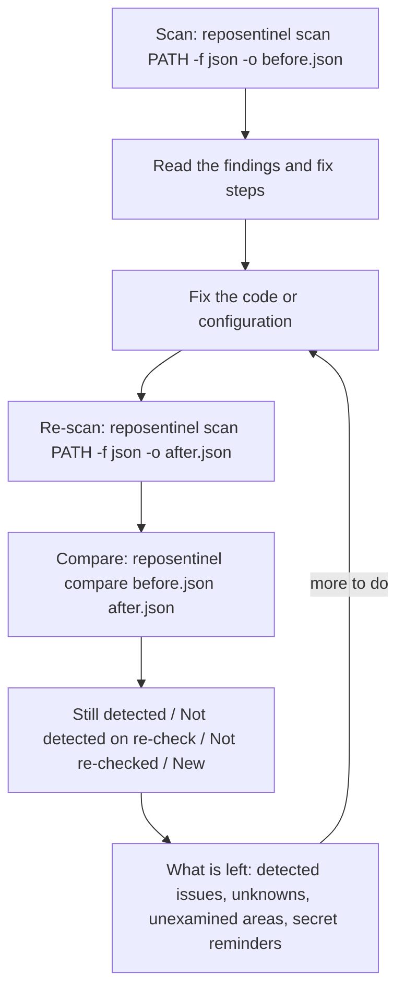
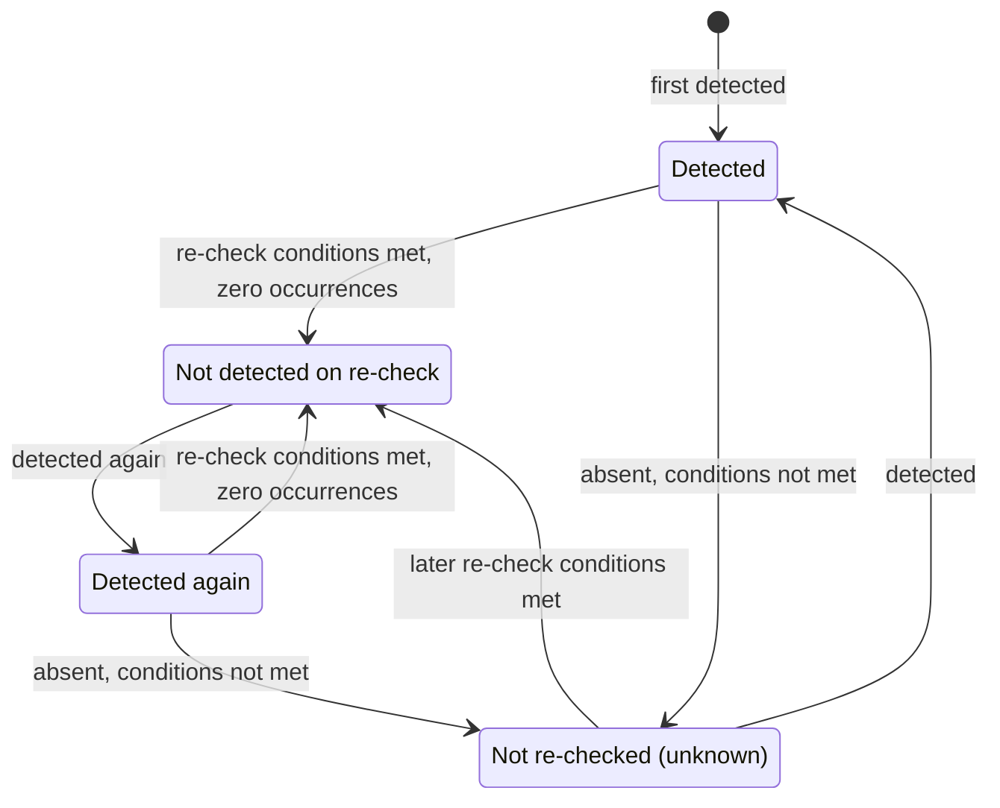
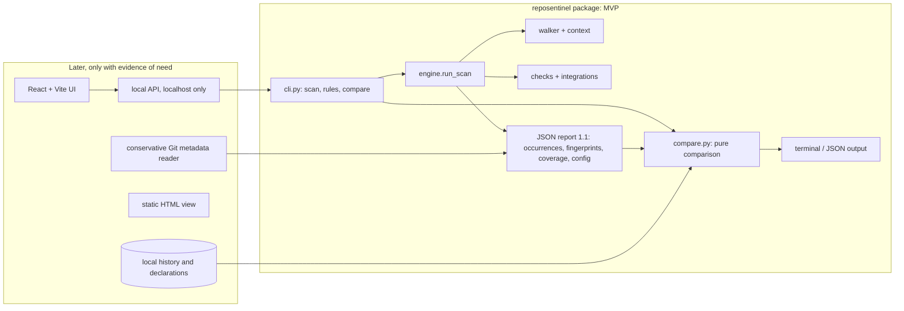

# RepoSentinel product strategy

> **Design document.** This records the product reasoning behind RepoSentinel's
> scope, statuses and wording, as written during its development. For using
> RepoSentinel, see the [README](../README.md).

Status: **revision 3**, proposal for owner review (2026-10-26). The product
direction is **provisional** until the validation step in section 12.3 has been
run with real users. Nothing in this document has been built unless it is
explicitly marked **Exists today**, apart from the comparison prototype below.

### Implementation note (2026-10-26): internal comparison prototype

At the owner's request, the stateless comparison MVP (section 6.2, F1 to F6:
fingerprints, rule versions, per-check examined files, scan configuration
record, `reposentinel compare` and per-rule re-check notes) was built as an
**internally tested prototype**, *before* the walkthrough in section 12.3. The
walkthrough has not been run, no external user has seen the prototype, and the
decision rules in section 11.2 have not been applied. AC-19 (comprehension)
is therefore unverified. How it works is described in the README and
`docs/architecture.md`. Decisions taken while building it, all on the
conservative side:

* **Configuration differences** (size, file-count or depth limit, default
  exclusion lists) make every finding that is absent from one scan "Not
  comparable", not only the "affected" ones, because RepoSentinel cannot tell
  which findings a different limit could have hidden (section 5.1, condition 4).
* **An integration requested in only one scan** fails re-check condition 1
  (the owning check did not run): its old findings are "Not re-checked" and
  its new findings "New (not examined before)". Exit code 3 applies.
* **A rule that exists in only one scan** (added or removed in another
  RepoSentinel version) gives "Not re-checked" (only in the old scan) or "New
  (not examined before)" (only in the new scan), never "Not detected".
* **"New"** also covers a finding in a file that was absent from a complete
  old listing (a newly added file), consistent with the rename row in 5.5.
* **The secret reminder** is conditional ("If this was a real credential ...
  If it was ever committed, it is still in Git history"), because
  RepoSentinel does not know whether the value was real or committed.
* `compare --format json` writes its own comparison schema (1.0). It is not a
  scan report and is not accepted as `compare` input.

### Implementation note (2026-10-27): leak fix and approved UI experiment

* **Scan-side leak closed.** Workflow findings used to copy step names, job
  IDs, expression text and YAML values into summaries and evidence, so a
  credential that the patterns do not recognise could reach reports. Finding
  text is now built only from RepoSentinel vocabulary, positions and line
  numbers ("Job 2, step 3"), and error messages never quote file content,
  exception text or tool output. Paths, URL host names and action
  `owner/repo` are still shown (README, "What is still shown as found").
* **Local UI (section 6.3, item 9), started early with the owner's explicit
  approval** as a limited prototype: `reposentinel ui`, a React page served by
  a standard-library server on 127.0.0.1 (no FastAPI, so no new runtime
  dependency; the trade-off is hand-written request validation, covered by
  tests). It reuses the engine, the loader, the comparison and the
  renderers, and follows threat T11 (section 9); see `docs/webui.md`. No
  history, accounts, AI or automatic fixes.
* **Validation status unchanged:** both remain internally tested only. The
  walkthrough (section 12.3) has still not been run, and no external user has
  used either the comparison or the UI.

### Implementation note (2026-10-27, later): release-readiness audit

No new features. Fixed: the UI session cookie was sent to every port of
127.0.0.1 (now scoped to a per-launch secret path, with an 8-hour lifetime);
the server could lose its reply to a refused request (the cause of a rare
test failure); URL-credential evidence no longer shows host names. Added a
reproducible release build (UI first, then sdist and wheel, then checks), CI
jobs for the frontend, the release archives and a real-browser test, and a
smoke test for installed wheels. Hosted CI has still never run, and nothing
has been validated by external users.

Later the same day, a focused review against RFC 6265 replaced the session
cookie with an in-memory bearer token: cookies are not isolated by port, so
a path-scoped cookie still reached any local service that learned the path.
The token is obtained once from a launch code in the URL fragment.

### Implementation note (2026-11-01): release preparation

No new security engines. The console was redesigned (original "ember"
visual identity), a synthetic demo project was added for first use, SARIF
output was validated against the official schema, and the release files and
documentation were prepared. The product's statuses and wording are
unchanged. External validation (section 12.3) is still outstanding and is
the recommended step before building further capabilities.

### Implementation note (2026-10-28): workspace, history and SARIF

At the owner's request, and still before any external walkthrough, the web
interface became a local console with registered projects, saved scan
history (SQLite in the per-user data folder, opt-in by registering a
project), automatic comparison with the previous scan, a "detected again"
signal, comparison of any two saved scans, and SARIF 2.1.0 export (CLI and
UI). The research, scoring and roadmap are in
[feature-research.md](feature-research.md). This extends the comparison
prototype in the direction section 6 describes as conditional; it does not
replace the walkthrough. History deliberately stores the redacted JSON
report, not a separate model, so every saved scan is validated by the same
loader as a report file, and the statuses and wording of section 5 are
unchanged ("no longer detected", never "fixed"). Still unvalidated: whether
developers want history at all, and whether the checklist wording is clear.

### What changed in revision 3 (final review before the walkthrough)

| Issue | Correction |
|---|---|
| Fingerprint safety | Workflow expression text is no longer an identity input. Identity inputs are now limited to RepoSentinel's fixed vocabulary and structural identifiers, and structural identifiers pass through credential redaction before hashing (sections 6.5 and 6.6, AC-12). |
| Identity terminology | Occurrences *share* their tracked finding's fingerprint and keep their own locations; no occurrence has a stable identity of its own (sections 5.1, 6.2, 6.5, 8.2). |
| Research mock-ups | Variant A now reads "3 findings are no longer detected, 1 remains", so both variants use honest wording and differ only in evidence detail. The observations that show whether the extra detail matters are defined (section 12.3). |
| Git history | The walkthrough discloses that RepoSentinel scans current files only, and tests whether that limits its usefulness, especially before making a private repository public (sections 11 and 12.3). Every "what is left" summary states that Git history was not scanned (section 7.2, AC-16). |
| Exit codes | `compare` exit codes have a fixed order of precedence (section 6.2, AC-20). |

### What changed in revision 2

| Issue | Correction |
|---|---|
| Competitive analysis | GitHub push protection, secret scanning and code scanning are now described separately, from current official docs. Push protection acts *at push time*, before the secret reaches GitHub; the earlier text wrongly implied all feedback arrives after a push. Differentiation claims were re-evaluated and narrowed (section 4). |
| Finding identity | The contradiction between rule/path identities and "distinct fingerprints for identical findings on different lines" is resolved: identities now group identical *occurrences* into one *tracked finding* with a count. The document no longer promises per-occurrence stability (section 6.5). |
| Verification wording | "Verified resolved" is replaced by conservative statuses such as "Not detected on re-check". The document explains why a rule no longer matching does not prove a fix, and treats actions outside the repository as user declarations only (section 5). |
| Privacy vs portability | MVP identities avoid secret-derived inputs, so they are portable across machines, exports and CI without a key (refined in revision 3: free repository text such as workflow expressions is excluded too). Value-level secret identity is deferred and, if ever added, stays local (section 6.6). |
| Former AC-21 (now AC-16) | The ban on the word "secure" is replaced by a precise rule against unsupported claims of overall security or unconditional readiness (section 10). |
| Scope | The MVP is smaller: a stateless comparison of two saved scans. History, decisions, Git revision and keys move to later phases. A user walkthrough experiment now comes **before** implementation (sections 6, 11 and 12). |
| Adjacent assumptions | Git metadata handling and local key protection are reviewed in detail, with explicit "unknown" results wherever safe support cannot be guaranteed (sections 8.5 and 8.6). |

How to read the labels used throughout:

| Label | Meaning |
|---|---|
| **Exists today** | Implemented in the current code and covered by tests (377 passed, 2 skipped on Windows in the last local run). |
| **Proposed** | A recommendation in this document. Not built. |
| **Assumption** | Believed but not yet checked with real users. Must be validated. |
| **Verified** | A competitor capability confirmed from official documentation (links in section 4). |
| **Interpretation** | My reading of what verified facts mean for us. Reasonable people may disagree. |
| **Unverified** | Not confirmed. Do not repeat it as fact. Absence from the pages read does **not** mean a competitor lacks a capability. |
| **Declared** | A statement made by the user and recorded as theirs. RepoSentinel never presents a declaration as something it verified. |

---

## 1. Executive recommendation

**Keep the direction "help builders handle security findings before they publish,
honestly", but treat it as a hypothesis, test it with users before building more,
and shrink the first implementation.**

What the evidence says (section 4, Verified):

* For **public repositories on GitHub**, a lot is already free and on by default:
  push protection for users blocks pushes containing many provider secrets
  *at push time*; secret scanning scans the whole Git history after code arrives;
  GitHub tokens are validity-checked and automatically revoked in public
  repositories; and CodeQL code scanning (free for public repositories) has
  queries for GitHub Actions code injection, untrusted checkouts in privileged
  workflows, unpinned action tags and missing permissions.
* Those GitHub checks run when code reaches GitHub (at push time, or afterwards
  in GitHub Actions). Some secret categories (generic patterns such as private
  keys and database connection strings, and passwords) are **not** push-protected
  by default.

What that means (Interpretation): RepoSentinel cannot win on detection, and for a
public GitHub repository with default settings its added value is narrower than
revision 1 suggested. The plausible remaining value is:

1. **Earlier, local feedback** before anything leaves the machine, including for
   categories that are not push-protected by default and for workflow problems
   that CodeQL would only report after a push.
2. **Contexts GitHub's free features do not cover:** private repositories without
   paid add-ons, other hosts, offline work (Verified that private repositories
   need GitHub Secret Protection or GitHub Code Security).
3. **An honest local answer to "what is left, and what was never checked?"**,
   including a conservative re-check after a fix. This is the central bet, and it
   is **unvalidated**.

**Recommended next step: a small walkthrough experiment with 5 to 8 target users
(section 12.3), using the existing CLI and hand-made output mock-ups, before any
of the proposed identity, comparison or history code is written.** It tests
whether people value the re-check and "what is left" answer at all, and which
pre-publication risk they actually worry about (current files, Git history, or
workflows).

**If validated, the MVP is deliberately small (section 6.2):** portable
fingerprints built only from RepoSentinel's own vocabulary and redacted
structural identifiers (never secret values or free repository text), rule
versions, a record of which files each check examined, and a stateless
`reposentinel compare OLD.json NEW.json` that reports conservative statuses ("Not
detected on re-check", "Not re-checked", and so on), a scoped "what is left"
summary that states Git history was not scanned, and fixed exit-code precedence. No history store, no decision
records, no fingerprint key, no Git metadata reading, no UI, no AI.

**Engineering that should continue meanwhile:** only the release foundation
(phase 0): license decision, first commit, CI green on GitHub's runners.

---

## 2. Problem definition and target persona

### 2.1 Primary persona (Assumption until interviews confirm it)

**The solo or small-team builder about to publish.** Example: a computer science
student or independent developer who:

* builds a project on their own machine (Windows or Linux), in Python or
  JavaScript, often with a `.env` file and copy-pasted GitHub Actions workflows;
* is about to make a repository public, share it with a recruiter or course
  marker, open-source it, or ship a first release;
* has no security engineer to ask and no paid security tooling (GitHub's free
  features cover public repositories; private repositories need GitHub Secret
  Protection or GitHub Code Security, Verified);
* learns security fixes from search results, AI chat answers and tutorials.

Secondary users, served by the same workflow but not designed for first: student
teams sharing one repository, and small teams without AppSec support.

### 2.2 Current workflow (persona behaviour is Assumption; GitHub behaviour is Verified)

1. **Write code.** Credentials end up in `.env` or, under time pressure, in a
   config file. Workflows are copied from tutorials.
2. **Commit locally.** Nothing checks local commits unless the person installed a
   pre-commit hook such as detect-secrets or Gitleaks (Assumption: most of the
   persona have not).
3. **Push to GitHub.** Feedback at this point depends on the destination:
   * **Public repository:** push protection for users is on by default and
     "stops you from pushing secrets to public repositories on GitHub". It acts
     *before* the secret reaches the repository, for patterns where push
     protection applies: most provider patterns by default; generic patterns
     (private keys, database connection strings) only if configured; passwords
     not at all (Verified). A blocked secret is still in the local commits and
     must be removed from them before pushing again.
   * **Private repository on the free plan:** push protection for users applies to
     public repositories; repository-level push protection is off by default and
     requires GitHub Secret Protection (Verified). So there is usually no
     push-time check (Interpretation).
   * **Other hosts:** not researched (Unverified).
4. **After the push (public repositories):** secret scanning scans the entire Git
   history on all branches and raises alerts; GitHub tokens are validity-checked
   and automatically revoked in public repositories; partner providers are
   notified for partner patterns. Code scanning, if enabled, runs in GitHub
   Actions on events such as pushes or on a schedule, and reports code and
   workflow alerts (Verified).
5. **Remediation.** GitHub's documentation says a committed secret should be
   considered compromised and rotated (Verified). Whether beginners follow that,
   or just delete the line and push again, is an **Assumption** to test.
6. **Making a private repository public.** The whole history becomes visible at
   once. What GitHub scans at that moment was not described in the pages read
   (Unverified).

### 2.3 The painful part (Interpretation and Assumption)

Detection is plentiful and, for public GitHub repositories, largely free. The
candidate pain points that remain are:

* **Before the push, there is no local overview.** Push protection only reports
  what it blocks, at push time, for the patterns it covers; workflow and code
  issues surface after the push, if code scanning is set up (Interpretation).
* **Which findings matter, and what does fixing them involve?** Especially the
  steps outside the code: rotating or revoking a credential and handling Git
  history (Assumption that beginners miss these, despite GitHub's guidance).
* **Did my fix work, and how would I know?** A warning that disappears may mean
  the problem is gone, or that the check no longer looked at that file, or that
  the fix merely stopped the pattern from matching (section 5.4).
* **What is still open, and what was never checked, before I publish?**
  (Assumption that this is a question the persona asks.)
* **RepoSentinel's own gap:** it does not scan Git history, which may be the
  largest pre-publication risk when a private repository becomes public
  (Interpretation). Whether users worry about this more than about current files
  is a key question for the experiment.

### 2.4 The job RepoSentinel should own (provisional)

> When I am about to push or publish my repository, help me see the few issues
> that could really hurt me, understand what fixing them involves (in and outside
> the code), and re-check my fix, so that I know what is left and what was never
> checked.

### 2.5 Why someone might use RepoSentinel (Assumption)

Not instead of GitHub's features, but **in addition**, earlier, and locally:

* It runs **before** anything is pushed, on the user's machine, without an
  account, an upload or a paid plan, including on private repositories and other
  hosts.
* It reports categories that push protection does not block by default (for
  example private key blocks and URLs with embedded passwords) and workflow
  problems, before the push.
* It is honest about what it did not check: a skipped or broken check is shown as
  unknown, never as a pass (Exists today in the scan outcome logic).
* It treats the user as the decision maker and never changes their code.

Where GitHub is stronger and RepoSentinel should not pretend otherwise: history-
wide secret scanning, provider notification, validity checks and automatic
revocation of GitHub tokens (all Verified for the stated plans and repository
types).

### 2.6 Alternatives considered

| Sharper problem | Why it is attractive | Why it is not the first focus |
|---|---|---|
| "I leaked a key, guide me through the response" | Concrete, high stakes | GitHub already gives guidance, validity checks and auto-revocation for GitHub tokens in public repositories (Verified); RepoSentinel cannot check validity offline. Fits *inside* the workflow as reminders, not as a product |
| GitHub Actions hardening | Common beginner mistakes | CodeQL (free for public repositories) and Zizmor (offline, MIT) already cover these patterns in depth (Verified). Integrate rather than compete |
| Secrets in Git history before going public | Possibly the biggest pre-publication risk | RepoSentinel does not scan history today, and doing it safely needs design work (open question 12.2). The experiment should test whether this is what users actually worry about |
| Tracking findings from any scanner (SARIF import) | Scanner-agnostic | Imported findings rarely carry coverage evidence; good follow-up |
| **Local pre-publication check with honest re-check** | Matches the persona's moment; builds on existing coverage reporting | **Recommended, provisionally**, pending the experiment |

---

## 3. Product promise and differentiation

### 3.1 Critical evaluation of "Find it. Fix it. Prove it."

| Part | Verdict | Reason |
|---|---|---|
| Find it | Necessary, not differentiating | GitHub (push protection, secret scanning, CodeQL including Actions queries), Semgrep, Snyk, Gitleaks and Zizmor detect far more than 12 rules can (Verified). |
| Fix it | Weakly differentiating at best | GitHub documents rotation guidance for secrets; Copilot Autofix, Snyk Agent Fix and Semgrep autofix propose code changes with human review (Verified). RepoSentinel's possible contribution is short, rule-specific guidance at the moment of the local scan (Interpretation). |
| Prove it | The right instinct, the wrong word | A scanner can show that a rule no longer matches in the files it examined. It cannot show that a security issue was correctly fixed (section 5.4), and it cannot verify actions outside the repository. |

**Recommendation (owner decision):** use a scoped public promise such as
**"Find it. Fix it. Re-check it."**, with the explanation "know what is still
detected, what is no longer detected, and what was never checked".

### 3.2 Positioning statement (Proposed, provisional)

> For independent developers and small teams without a security specialist,
> RepoSentinel is a local-first command-line check to run before you push or
> publish. It points out a small set of high-impact problems, explains what
> fixing them involves, and re-checks your work, telling you plainly what is
> still detected, what is no longer detected, and what it did not check. It runs
> on your machine, needs no account, complements GitHub's own protections, and
> never claims your repository is secure.

### 3.3 The core problem RepoSentinel owns (provisional)

**A trustworthy local answer to "what is left, and what was not checked?" before
publishing.** Detection breadth, organisation dashboards, policy management and
compliance reporting are not ours.

### 3.4 Product principles

1. **Evidence, not reassurance.** Every status must be backed by recorded
   evidence the tool actually has, and must state its scope. RepoSentinel may say
   "the checks that ran did not detect X in the files they examined". It never
   claims or implies that a repository, application or release is secure, safe
   or ready overall. There is no overall security score. Ordinary security
   terminology (rule names, "security issue", "secure configuration" in fix
   guidance) is fine.
2. **Unknown is not a pass.** A check that failed, was skipped, could not read a
   file, or did not examine a location produces *unknown*, shown with the same
   prominence as detected issues (Exists today for scan outcomes: an incomplete
   scan exits with code 3 and is never called clean).
3. **Local by default, private always.** Repository contents, findings and any
   history stay on the user's machine. Nothing is sent anywhere, including to an
   AI provider, without an explicit per-use opt-in that shows exactly what would
   be sent. Raw secrets are never stored or displayed, and identities are never
   derived from secret values in anything that can leave the machine.
4. **The user decides; the tool shows its work.** RepoSentinel recommends; it
   never changes user files silently. Any later proposed change is a diff applied
   only after explicit approval. Statements about actions outside the repository
   are recorded as **Declared**, never as verified.
5. **Small and correct before big.** A few rules and one complete workflow, each
   with honest limitations, beat many shallow features. Build only what the
   validated user job needs.

---

## 4. Evidence-based competitor comparison

Method: official documentation only, read on 2026-10-25. Each fact links to its
source. When a page did not answer a question, the point is marked Unverified.
**A capability not mentioned in the pages read may still exist.**

### 4.1 GitHub: three different capabilities

| Capability | When it acts | What it covers | Availability | Source |
|---|---|---|---|---|
| **Push protection** | At push time; "blocks pushes that contain secrets *before* they reach your repository" | Most provider patterns by default; generic patterns (private keys, database connection strings) configurable but not on by default; passwords not supported; only recent token versions | **For users:** on by default, "stops you from pushing secrets to public repositories on GitHub". **For repositories/organisations:** off by default, requires GitHub Secret Protection | [about-push-protection](https://docs.github.com/en/code-security/secret-scanning/introduction/about-push-protection), [supported patterns](https://docs.github.com/en/code-security/secret-scanning/introduction/supported-secret-scanning-patterns) |
| **Secret scanning** | After content is on GitHub; "scans your entire Git history on all branches" | Provider patterns, with partner providers notified. Generic and AI-detected pattern categories also exist; which plans and repository types include them was not stated in the pages read (Unverified) | Public repositories by default; private repositories need GitHub Secret Protection | [about-secret-scanning](https://docs.github.com/en/code-security/secret-scanning/introduction/about-secret-scanning), [github-security-features](https://docs.github.com/en/code-security/getting-started/github-security-features) |
| ... validity checks and revocation | On alerts | GitHub tokens validity-checked by default; GitHub "auto-revokes GitHub tokens in public repositories"; partner-pattern validity checks need GitHub Team or Enterprise with Secret Protection; not supported for generic patterns | As stated | [evaluating-alerts](https://docs.github.com/en/code-security/secret-scanning/managing-alerts-from-secret-scanning/evaluating-alerts), [supported patterns](https://docs.github.com/en/code-security/secret-scanning/introduction/supported-secret-scanning-patterns) |
| ... remediation guidance | On alerts | "Once a secret has been committed to a repository, you should consider the secret compromised"; rotate, review services, check logs | Docs | [resolving-alerts](https://docs.github.com/en/code-security/secret-scanning/managing-alerts-from-secret-scanning/resolving-alerts) |
| **Code scanning (CodeQL)** | Runs in GitHub Actions on events such as a push, or on a schedule | Code, and "GitHub Actions workflows" as a supported language. Actions queries include code injection, checkout of untrusted code in a privileged context, unpinned tags and missing workflow permissions | Public repositories by default; private repositories need GitHub Code Security | [about-code-scanning](https://docs.github.com/en/code-security/code-scanning/introduction-to-code-scanning/about-code-scanning), [about-codeql](https://docs.github.com/en/code-security/code-scanning/introduction-to-code-scanning/about-code-scanning-with-codeql), [CodeQL Actions queries](https://codeql.github.com/codeql-query-help/actions/), [github-security-features](https://docs.github.com/en/code-security/getting-started/github-security-features) |
| ... alert tracking | Across runs | Fingerprints (`partialFingerprints`, `primaryLocationLineHash`); a changed file path creates a new alert and closes the old one; dismissed alerts can be re-opened manually | | [sarif-support](https://docs.github.com/en/code-security/code-scanning/integrating-with-code-scanning/sarif-support-for-code-scanning), [resolving-code-scanning-alerts](https://docs.github.com/en/code-security/code-scanning/managing-code-scanning-alerts/resolving-code-scanning-alerts) |
| ... Copilot Autofix | On CodeQL alerts | Suggested fixes for a subset of CodeQL queries; "explicit developer review and acceptance"; sends alert data and code snippets to LLMs; non-deterministic | Public repositories by default | [responsible-use-autofix](https://docs.github.com/en/code-security/code-scanning/managing-code-scanning-alerts/responsible-use-autofix-code-scanning) |

Unverified for GitHub: exactly how a code scanning alert is decided to be "fixed"
(for example when an analysis did not cover a file), which patterns *push
protection for users* applies (beyond the repository-level defaults listed), and
what happens when a private repository is made public.

### 4.2 Other tools (short)

* **Semgrep.** The AppSec Platform marks a finding **Fixed** when it is "no longer
  detected in the most recent scan of that same branch", and **Removed** when the
  rule was disabled or changed or the file was deleted, renamed or ignored
  ([triage-remediation](https://docs.semgrep.dev/semgrep-code/triage-remediation)).
  Its AI layer requires the platform and names OpenAI with Amazon Bedrock as
  fallback ([assistant overview](https://docs.semgrep.dev/semgrep-assistant/overview)).
  The Community Edition CLI scans locally without a login step; default rules
  come from the Semgrep Registry
  ([quickstart-ce](https://docs.semgrep.dev/getting-started/quickstart-ce)).
  CLI-only finding tracking: Unverified.
* **Snyk.** Standard Snyk Code analysis sends bundled source files to Snyk; a
  local no-upload engine exists for some customers
  ([snyk-code](https://docs.snyk.io/scan-with-snyk/snyk-code)). Snyk Agent Fix
  requires human review and tells users to rescan after applying
  ([agent-fix](https://docs.snyk.io/scan-application-code/snyk-code/fix-code-issues-automatically-with-snyk-ide-plugin-beta)).
  Ignores support reasons and expiry
  ([ignore-issues](https://docs.snyk.io/manage-risk/prioritize-issues-for-fixing/ignore-issues)).
* **Local baseline tools.** detect-secrets keeps a `.secrets.baseline`, re-scans
  against it and has an `audit` command to label results; it may verify some
  secrets "via network call" unless `--no-verify` is used
  ([detect-secrets](https://github.com/Yelp/detect-secrets)). Gitleaks supports
  a baseline report of ignored findings (`--baseline-path`, read from its
  [source](https://raw.githubusercontent.com/gitleaks/gitleaks/master/cmd/root.go)
  in an earlier milestone). Zizmor audits workflows offline by default
  ([zizmor usage](https://docs.zizmor.sh/usage/)).

Not used: SonarQube issue lifecycle (the page read did not describe it), pricing,
market share.

### 4.3 What this means for the target user (Interpretation)

| Situation | What already helps | Where RepoSentinel might add something |
|---|---|---|
| Public GitHub repository, default settings | Push-time blocking for most provider secrets; history-wide secret scanning; GitHub token validity checks and auto-revocation; CodeQL including Actions, once code is pushed | Local feedback before the push; categories not push-protected by default; a re-check and "what is left / not checked" summary before publishing |
| Private repository on the free plan | Push protection for users does not apply (it covers public repositories); paid add-ons needed for scanning | Most of RepoSentinel's checks apply here before and after pushing |
| Other hosts or offline work | Not researched | All of RepoSentinel's checks apply |
| A secret already committed | GitHub guidance, validity checks for some token types, auto-revocation of GitHub tokens in public repositories | Only reminders: RepoSentinel cannot verify rotation or history clean-up |

### 4.4 Differentiation claims, re-evaluated

| Candidate claim | Overlap with verified capabilities | What remains (Interpretation) | Evidence still needed |
|---|---|---|---|
| Earlier, local feedback before push | Push protection is earlier than revision 1 implied, but only at push time and for covered patterns; CodeQL runs after push | A local check of current files and workflows before committing or pushing | Do users want a pre-push check, or is push protection enough? |
| Coverage-aware re-check ("not detected" only where the check examined the file) | Semgrep distinguishes Fixed from Removed; GitHub tracks alerts by fingerprint | A conservative local re-check whose statuses always say what was examined. Whether competitors already account for per-file coverage is Unverified, so this is **not** claimed as unique | Do users notice or care about the difference? |
| Honest unknowns in the summary | Not found in the pages read (Unverified; may exist) | Making "what was never checked" part of the answer | Does it change what users do? |
| Secret follow-up honesty ("not detected" is not "safe") | GitHub's guidance says committed secrets are compromised; GitHub verifies some token types | Reminders at the local re-check; RepoSentinel adds nothing that GitHub's validity checks do better | Do users act on reminders? |
| Works without GitHub's paid features | Verified that private repositories need paid add-ons | Value for private repositories and other hosts | Is the persona's work mainly in private repositories before publishing? |

**Net assessment (Interpretation):** RepoSentinel's realistic position is a
small, honest, local *complement* to GitHub, most valuable before code leaves the
machine and where GitHub's free features do not apply. That is a narrower niche
than revision 1 described, and its value depends on behaviours that have not yet
been observed. Hence the experiment first.

---

## 5. Core user journeys, verification terms and finding lifecycle

### 5.1 Terms (Proposed)

* **Occurrence:** one match reported by a scan, with rule, path, line and
  redacted evidence. This is what the scanner reports today (Exists today as
  `Finding`).
* **Identity inputs and fingerprint:** a few values per occurrence (section 6.5)
  are hashed into a **fingerprint**. Occurrences with the same identity inputs in
  one scan get the same fingerprint.
* **Tracked finding:** all occurrences in a scan that share one fingerprint, for
  example "GitHub token pattern in `app/settings.py`, 2 occurrences". Each
  occurrence keeps its own location (path and line), but **no occurrence has a
  stable identity of its own**: only the tracked finding is followed from scan to
  scan. Comparison between scans works on tracked findings.
* **Re-checked:** a later scan B re-ran the check that owns the rule *and* that
  check examined the file. Evidence required, all recorded in scan B:
  1. the owning check has status `completed`;
  2. the file is in that check's examined-files record, with no coverage issue
     (not unreadable, binary, too large, unparseable, excluded or a link);
  3. the rule version is the same as in scan A;
  4. the scan configuration that affects what the check could see (limits and
     exclusions) is the same as in scan A. If it differs, the finding is "Not
     comparable" and the difference is shown. (An integration that did not run
     in scan B already fails condition 1.)
* **Not detected on re-check:** re-checked, and zero occurrences of the tracked
  finding were found. This is the strongest positive statement RepoSentinel makes
  about a finding.
* **Not detected: file removed:** the file does not exist in scan B, and scan B's
  traversal was complete for its location (no limit reached; no ancestor
  directory unreadable, excluded or a link).
* **Not re-checked:** the finding is absent from scan B, but at least one
  re-check condition failed. A reason is always shown.
* **Declared by you** (later phase): a user statement about something RepoSentinel
  cannot observe, such as "credential rotated", "history cleaned" or "accepted
  risk". Stored with time and note; never shown as verified.

### 5.2 The main journey (Proposed; MVP form uses two saved reports)

1. **Scan.** The existing `scan` command, saving JSON (Exists today, minus the new
   identity and coverage fields).
2. **Understand.** The existing report explains each occurrence: severity,
   confidence, redacted evidence, location, remediation (Exists today). Proposed
   addition: per-rule "what a re-check can and cannot show" text (section 5.4).
3. **Fix.** The user edits files. RepoSentinel changes nothing.
4. **Re-scan and compare.** `compare` prints only what changed, with evidence
   lines, for example: "Not detected on re-check: RS-GHA-001 in
   .github/workflows/ci.yml; the GitHub Actions check examined this file in both
   scans with rule version 1." Or: "Not re-checked: app/config.json was skipped in
   the new scan (larger than the size limit)."
5. **What is left.** A scoped summary (section 7.2): what is still detected, what
   is new, what could not be re-checked, which files or checks were not examined,
   and reminders for secrets.

Later phases (section 6.3) add a local history so that the user does not manage
report files, user declarations, and "detected again" tracking across many scans.

### 5.3 Statuses (Proposed)

MVP statuses, produced by `compare` from two reports:

| Status | Meaning | Counts as "left to do"? |
|---|---|---|
| New | Detected in the new scan, not in the old one, and the old scan examined that file | Yes, if at or above the threshold |
| New (not examined before) | Detected now; the old scan did not examine that file, so it may not be new | Yes, if at or above the threshold |
| Still detected | Detected in both; the occurrence count is shown (for example "2 to 1") | Yes, if at or above the threshold |
| Not detected on re-check | Section 5.1 | No, but secret reminders still apply |
| Not detected: file removed | Section 5.1 | No, but secret reminders still apply |
| Not re-checked | Absent, but the re-check conditions are not met; reason shown | Yes, as an unknown |
| Not comparable | Rule version or relevant configuration differs between the scans | Yes, as an unknown |

Later, with local history (phase 4), one more observed status and the user
declarations become possible:

| Later user declaration | Meaning | Rules |
|---|---|---|
| Accepted risk | "I know, and I will live with it for now" | Reason required; expiry suggested; an expired acceptance counts as left to do again |
| False positive | "This match is not a real problem" | Reason required; tied to the tracked-finding identity |
| Actions outside the repository | "Credential rotated", "history cleaned", "provider informed" | Free text; always shown as "Declared by you"; never changes an observed status |

Removed from revision 1: "Verified resolved" (it implied more than a pattern
check can show) and "Remediation proposed" (no behaviour until fix proposals
exist).

### 5.4 Why "not detected" is not "fixed"

An unchanged rule version and a changed file show only that **this rule, with
its documented limitations, no longer matches in the files it examined**. They do
not show that the risk is gone, because:

1. **Rules detect patterns, not vulnerabilities.** A change can stop the pattern
   from matching without removing the risk. Examples from RepoSentinel's own
   rules (all consistent with their documented limitations):
   * RS-SEC-004: the token is split into concatenated strings or base64-encoded.
     The token is still there and still valid.
   * RS-SEC-003: the variable is renamed from `aws_secret_access_key` to `key2`.
     The name-based rule no longer matches.
   * RS-HYG-001: `.env` is renamed to `settings.cfg`. The secrets are unchanged.
   * RS-GHA-001: the expression is moved into `env:` (the recommended fix), but the
     script then runs `eval "$TITLE"`, which is still injectable and invisible to
     the rule.
   * RS-GHA-002: `actions/checkout` is replaced by a `git fetch` of the pull
     request in a `run:` step. The rule only looks at `actions/checkout`.
   * RS-GHA-003: the action is pinned to the full SHA of a malicious commit. The
     rule is satisfied; the risk is not.
2. **The content may have moved somewhere that is not examined:** an excluded
   directory, a file over the size limit, a binary file, or a linked path.
   RepoSentinel cannot follow the content, so the "what is left" summary always
   lists unexamined areas.
3. **Rules have known false negatives** (documented per rule in `docs/rules.md`).
4. **The fix may introduce problems the rules do not detect.**
5. **For secrets, the risk is outside the file.** A committed credential stays in
   Git history and stays valid until it is rotated or revoked. GitHub's own
   guidance is to consider it compromised (Verified). RepoSentinel cannot observe
   rotation, revocation or history rewriting, and does not contact providers
   (offline principle). These can only ever be **Declared**.
6. **A changed file proves nothing by itself.** Any edit changes a file. It is
   not even required as evidence: the re-check conditions in 5.1 are what matter.

Consequences for the product:

* The strongest status is "Not detected on re-check", never "fixed" or "resolved".
* Every rule gets a short "what a re-check can and cannot show" note.
* Every secret finding that is no longer detected shows: "Treat the credential as
  compromised: rotate or revoke it. It remains in Git history. RepoSentinel cannot
  confirm either step."

### 5.5 Edge cases

| Situation | Behaviour (Proposed) |
|---|---|
| New scan incomplete (outcome `incomplete`) | Comparison still runs. Findings it detected are reported normally. Absences are "Not re-checked" wherever the re-check conditions fail for that finding. The summary can never be free of unknowns while a check failed or was skipped. |
| Rule version differs | Findings of that rule are "Not comparable (rule changed)" unless detected in both scans |
| Relevant configuration differs (limits, exclusions) | Findings absent from either scan are "Not comparable (configuration changed)"; differences listed |
| Integration requested in only one scan | Its findings are "Not re-checked" (check did not run in the new scan) or "New (not examined before)" (did not run in the old scan) |
| Lines inserted, or occurrences moved within a file | Same tracked finding; occurrence lines updated (section 6.5) |
| File renamed or moved | Old tracked finding: "Not detected: file removed" (if traversal complete); new path: "New". RepoSentinel does not claim it is the same issue (GitHub also creates a new alert on a path change, Verified) |
| Secret value changed in place | Same tracked finding, "Still detected". Value-level identity is deliberately not used (section 6.6) |
| One of two identical occurrences removed | "Still detected (2 to 1)"; for secrets, a reminder that a removed credential may still be valid |
| Reports with different target paths | The same repository has a different absolute path on another machine or in CI, so a path difference cannot prove anything either way. `compare` refuses by default and proceeds only with an explicit flag (for example `--different-roots`); the output then states that RepoSentinel could not confirm both reports describe the same repository (it records no Git revision in the MVP) |
| Malformed report, or unknown or newer schema | `compare` refuses with a clear error and a non-zero exit code; nothing is reported as not detected |
| Imported findings without coverage data (later) | Can be detected or new, but absences are always "Not re-checked (no coverage evidence)" |

---

## 6. MVP scope and exclusions

### 6.1 Before building: the walkthrough experiment

Section 12.3. It needs no product code: the existing CLI, the demo repository
script and hand-written mock-ups of `compare` output are enough. The MVP below is
built **only if** the experiment supports it (decision rules in section 11.2).

### 6.2 Minimum technical foundation (the MVP, conditional)

| # | Capability | Status today | Why it is the minimum |
|---|---|---|---|
| F1 | A `fingerprint` on every occurrence, computed from the identity inputs in section 6.5. Occurrences of the same tracked finding carry the same fingerprint; each keeps its own path and line | Missing: the engine's de-duplication key includes the line number | Nothing can be compared across scans without it |
| F2 | Rule versions | Missing | Re-check condition 3 |
| F3 | Per-check examined-files record (paths only, no content digests) | Missing: only per-check counts exist | Re-check condition 2 |
| F4 | Scan configuration record (tool version, rule versions, limits, exclusion list version, integrations requested) | Partly: tool version is recorded | Re-check condition 4 and "not comparable" |
| F5 | `reposentinel compare OLD.json NEW.json`: pure comparison, statuses from 5.3, evidence lines, "what is left" summary, secret reminders, and the exit codes below | Missing | The user-visible loop |
| F6 | Per-rule "what a re-check can and cannot show" text | Partly: limitations text exists | Prevents overclaiming |

The JSON report keeps one entry per occurrence (backwards compatible) and gains
additive fields: `fingerprint` on each occurrence entry (entries that share a
fingerprint belong to the same tracked finding), `rule_version`,
`coverage_by_check` and `scan_config`. Schema version 1.1. `scan` behaviour,
findings and exit codes stay exactly as they are.

**`compare` exit codes, in fixed order of precedence** (the first rule that
applies decides; the printed output always lists every category, whatever the
exit code):

| Precedence | Exit code | Condition |
|---|---|---|
| 1 | 2 | Invalid input: a report is unreadable, malformed, oversized or of an unknown or newer schema, or the target paths differ and the explicit flag was not given. No comparison output is produced |
| 2 | 3 | The comparison ran but contains at least one unknown: any tracked finding "Not re-checked" or "Not comparable", any check failed or skipped in the new scan, or any coverage error in the new scan. Applies regardless of severity and regardless of `--fail-on`, including `--fail-on never` |
| 3 | 1 | No unknowns, and at least one tracked finding "Still detected", "New" or "New (not examined before)" at or above the `--fail-on` threshold |
| 4 | 0 | None of the above |

This mirrors the existing `scan` policy, where an incomplete scan (exit 3) takes
precedence over findings (exit 1) because results may be missing (Exists today in
`engine.exit_code_for`). The old scan's completeness affects only the statuses
(for example "New (not examined before)"), never the exit code directly.

### 6.3 Later enhancements (each needs its own evidence of need)

1. Local history store, so users do not manage report files, plus "detected again"
   tracking.
2. User declarations: accepted risk (with expiry), false positive, and actions
   outside the repository (always shown as Declared).
3. Git revision in scan records, using the conservative reader in section 8.5.
4. Static HTML view of comparison and history (reuses the safe HTML renderer).
5. Deterministic, reviewable fix proposals for one or two mechanical cases.
6. Git history scanning for secrets (open question 12.2).
7. Zizmor, and a Gitleaks integration that has been tested against a real
   binary, feeding the same comparison.
8. SARIF export and import.
9. Local API and UI, only if the CLI proves insufficient in usability tests.
10. Optional AI explanations with explicit consent.

### 6.4 Explicitly out of scope for now

Dashboard, server, accounts or hosted service; AI; automatic file changes; any
overall score; new detection rules; team or CI history sync; compliance or policy
features; claims of complete secret detection or of proving security.

### 6.5 Identity specification

**Principle:** identity inputs must be stable and must never make a fingerprint
reveal more than the report itself shows. Repository text is never assumed to be
free of secrets. The algorithm promises exactly the stability listed below, and
nothing more.

**Allowed identity inputs (exactly two classes):**

1. **RepoSentinel vocabulary:** values chosen from lists defined in RepoSentinel's
   own code, never copied from the repository. Examples: the rule ID; the
   private-key type label (`RSA`, `OPENSSH`, ...); the name of the untrusted
   context matched by RS-GHA-001, *normalised* so that any array index taken from
   the repository (`commits[0]`, `commits[x]`) becomes `[*]`; the kind of script
   (`run` or `github-script`); the scope word `workflow`.
2. **Structural identifiers** from the repository: the relative path, the
   workflow job ID, and the `owner/repo` of an action. Before hashing, each is
   passed through the same credential-pattern redaction that the engine applies
   to report text (Exists today: `redact_known_secrets`). A fingerprint can
   therefore never encode a value that matches a supported credential pattern.

**Never identity inputs:** workflow expressions, script text, step names, YAML
values, matched secret values, any file content, and line numbers.

**Fingerprint:** `rs1:` followed by the SHA-256 hex digest of a canonical JSON
array of the identity inputs (UTF-8, no extra whitespace), so it is deterministic
on every platform. Paths are the existing POSIX-style paths relative to the
scanned root.

**Tracked finding = all occurrences with the same fingerprint in one scan.** Every
occurrence carries that shared fingerprint plus its own location (path and line).
The tracked finding records the occurrence count and the lines. No occurrence has
a stable identity of its own.

| Rules | Identity inputs | Consequence |
|---|---|---|
| RS-HYG-001..003 | rule, path | One tracked finding per file |
| RS-SEC-001 | rule, path, key type label | Two private keys of the same type in one file form one tracked finding with 2 occurrences |
| RS-SEC-002..005 | rule, path | All matches of one rule in one file form one tracked finding; the count tells them apart |
| RS-GHA-001 | rule, path, job ID, normalised untrusted context, kind of script | All occurrences that expand the same untrusted context into the same kind of script within one job form one tracked finding, whatever the surrounding expression text and step order |
| RS-GHA-002 | rule, path, job ID | |
| RS-GHA-003 | rule, path, action `owner/repo` (without the ref) | Changing `@v2` to `@v3` keeps it detected; pinning every use to a SHA makes it not detected |
| RS-GHA-004 | rule, path, `workflow` or job ID | |
| Gitleaks (experimental) | rule, path | Gitleaks rule IDs come from the built-in configuration RepoSentinel forces, not from the repository; RepoSentinel never reads Gitleaks' secret fields |

Behaviour this guarantees and does not guarantee:

| Scenario | Behaviour |
|---|---|
| Lines inserted above or between occurrences | Same fingerprint; lines updated |
| Occurrence moved within the file | Same fingerprint |
| Repeated identical occurrences in one file | One tracked finding with a count. Removing one shows "2 to 1"; no attempt to say *which* one was removed |
| Identical secret in two files | Two tracked findings (different paths). Not linked as "the same credential" |
| Secret value changed in place | Same fingerprint, "Still detected". The change is not detected as a different credential |
| Two different secrets of one rule in one file | One tracked finding, count 2 |
| File renamed or moved | New fingerprint at the new path; the old one is "Not detected: file removed" |
| Job renamed (RS-GHA rules) | New fingerprint; the old one becomes not detected |
| Workflow expression edited (RS-GHA-001) | Same fingerprint, unless the untrusted context or the kind of script changes |
| Two different expressions using the same untrusted context in one job | One tracked finding, 2 occurrences |
| A path, job ID or `owner/repo` that matches a credential pattern | Hashed in redacted form. Two such identifiers that redact to the same text share a fingerprint (accepted, rare) |
| Rule version changed | Same fingerprint format, but comparisons for that rule are "Not comparable" |

Residual limitation: a path, job ID or `owner/repo` that contains a secret in a
format RepoSentinel does not recognise is hashed as it is. It is also displayed as
it is in today's reports (paths are shown unredacted; job IDs and action names
pass through the same redaction as other report text). So the fingerprint reveals
nothing that the report does not already show.

Revision 1's criterion "identical findings on different lines keep distinct,
stable fingerprints" is withdrawn. Per-occurrence identities would need ordinals
or line-based hashes, which change when lines are inserted or reordered, so the
promised stability could not be delivered.

### 6.6 Privacy and portability

**MVP decision: identity inputs are limited to RepoSentinel vocabulary and
redacted structural identifiers (section 6.5); no secret value, free repository
text or file content digest is ever hashed into a fingerprint or written to a
report.**

* **Portable:** identical inputs give identical fingerprints on Windows, Linux and
  macOS, on any machine and in CI. Fingerprints can appear in exported JSON and be
  compared across machines. They do not contain secret values by construction,
  and they reveal no more than the report already shows (section 6.5, residual
  limitation). This is a narrower claim than "contains nothing secret", which
  RepoSentinel cannot guarantee for text chosen by the repository's author.
* **Supported comparisons:** any two reports of the same repository made by
  RepoSentinel versions with the same rule versions and comparable configuration,
  on the same or different machines, including a CI report against a local one.
  When the absolute target paths differ (always the case across machines), the
  user must confirm with an explicit flag that both reports describe the same
  repository, and the output says this was the user's statement, not something
  RepoSentinel checked.
* **Not supported:** distinguishing one secret value from another; linking the
  same credential across files; comparing across different rule versions or
  relevant configuration (the result is "Not comparable", never a guess);
  confirming that two reports with different target paths describe the same
  repository (only the user can declare that, with the explicit flag above).
* **Why not a keyed hash of the secret (revision 1's design):** a per-user HMAC
  key makes identities different on every machine and in every fresh CI runner,
  so exported reports and CI comparisons would silently stop matching. Making it
  portable would require a shared or fixed key, or an unkeyed hash, and an
  unkeyed hash of a short password can be brute-forced from a shared report. That
  would weaken secret protection, which the principles forbid.
* **If value-level identity is ever needed (later, only with evidence):** a keyed
  HMAC stored in a local-only history, never written to exported reports, never
  used in CI, and treated as "not comparable" whenever the key is missing or
  changed. Key handling requirements are in section 8.6.
* **Content digests** (used in revision 1 as a "file changed" condition) are
  dropped from the MVP: they are not evidence of a fix (section 5.4), and a plain
  SHA-256 of a file containing a short secret could help someone confirm a guess.

---

## 7. Proposed UX and information architecture

### 7.1 Interface identity: a case file, not a dashboard

Each tracked finding is a **case** with a short evidence trail: when it was
detected, what each re-check observed, and why its status is what it is. The
product reads like a careful logbook, not a control room.

Interaction rules for every command and view:

* **Questions first.** What needs attention? Why does it matter? What can I
  safely do next? What happened when I tried? What is still unknown?
* **Words before colours.** Statuses are spelled out ("Not re-checked: file
  larger than the size limit"); colour only reinforces them.
* **Unknowns are never hidden.** The unknown section is always shown, even when
  it says "0 unknown", followed by what was examined.
* **No scores, gauges or decorative charts.** Counts appear as plain text next
  to the list they summarise.
* **Scope in every positive statement.** "Not detected on re-check by the
  GitHub Actions check in the 2 workflow files it examined", never "fixed".

### 7.2 Views

The same information architecture applies to the CLI (MVP), a later static HTML
view and any later UI.

1. **What is left (default `compare` output):**
   * Still detected and New, at or above the threshold, grouped by severity.
   * Unknown: Not re-checked and Not comparable items, failed or skipped checks,
     with reasons and how to turn each unknown into a re-check.
   * Not examined: excluded directories, skipped files and limits from the new
     scan (Exists today in the scan report's coverage section).
   * Secret reminders for every secret finding that is no longer detected.
   * Not detected on re-check, each with its evidence line.
   * A final sentence that always carries scope, for example: "Of 5 tracked
     findings in before.json, 3 were not detected on re-check, 1 is still
     detected and 1 could not be re-checked. Checks run: 3 of 3. Files examined:
     47. This describes these checks on the current files only; Git history was
     not scanned."
2. **Case (finding detail, later):** status in plain words, why it matters,
   redacted evidence, fix steps, what a re-check can and cannot show, and the
   evidence trail.
3. **Logbook (scan history, later):** one line per scan with date, revision if
   known, rule versions, checks and their status, coverage summary.
4. **Change review (later, with fix proposals):** the diff, what it does and does
   not address, and an explicit apply step. Never "apply all".

### 7.3 What delivers the most value first

The **"What is left" output of `compare`**. It is the moment the product's
promise becomes visible, and it can be mocked up by hand for the experiment
before any code exists.

---

## 8. Technical architecture and key decisions

### 8.1 What exists today and is reused unchanged

| Module | Responsibility (Exists today) | Role |
|---|---|---|
| `walker.py` | Safe file inventory: no links or junctions, limits, exclusions, file identity re-checks | Source of coverage truth |
| `context.py` | Read-only file access with identity check after open | Gives checks content |
| `checks/*` | Hygiene, secrets and workflow rules; `Check` interface | Will also emit identity inputs (section 6.5) and examined paths |
| `engine.py` | Runs checks in isolation, redacts every text field, sorts, decides outcome and exit code | Stays the only place that runs checks |
| `models.py` | Frozen dataclasses | Extended additively |
| `reporting/*` | Safe terminal, JSON and HTML renderers | Reused for `compare` output |
| `integrations/*` | Hardened subprocess runner; experimental Gitleaks adapter | Unchanged |
| `cli.py` | Typer CLI and exit-code policy | Gains `compare` |

### 8.2 Missing pieces for the MVP (Proposed)

| Piece | Purpose |
|---|---|
| `Finding.fingerprint` | The fingerprint of the tracked finding this occurrence belongs to, shared with its sibling occurrences; computed by the check from the identity inputs in section 6.5, with structural identifiers redacted first. The occurrence keeps its own path and line |
| `Rule.version` | Integer bumped whenever matching behaviour changes |
| Examined paths in `CheckOutput` | Per-check coverage |
| Scan configuration in `ScanReport` | Limits, exclusions version, rule versions, integrations |
| `compare.py` | Pure function: (report A, report B) to statuses, evidence lines and summary; no I/O; table-driven tests |
| `compare` CLI command | Loads two JSON files defensively (size limit, schema check), renders the result |

No new dependency, no persistence, no key, no Git reading.

### 8.3 Target architecture

### 8.4 Key decisions and trade-offs

| Decision | Recommendation | Trade-off |
|---|---|---|
| Where security logic lives | Only in the Python package; any API or UI is a thin adapter | Prevents diverging implementations |
| Comparison without history | Stateless `compare` of two report files | The user manages files; no "detected again" across many scans until history exists |
| Identity inputs | Non-secret only | Cannot tell secret values apart; in exchange, portable and key-free |
| Content digests | Not recorded | No "file unchanged" consistency check; avoids a guessing aid |
| Git revision | Deferred; when added, explicit "unknown" for anything not safely supported | Reports do not say which commit was scanned until then |
| Future server stack | If ever built: FastAPI as an optional extra serving pre-built React/Vite assets | Dependencies only for users who opt in |
| Running Git | Never in a scanned repository | Some Git facts stay unknown |

### 8.5 Git metadata handling (later phase; review of revision 1's assumption)

Revision 1 proposed reading the commit "from `.git/HEAD`, refs and
`packed-refs`". That hides real complexity, and some of it crosses the
repository boundary. Proposed conservative behaviour: report a revision only in
the simple, safe cases; otherwise report `unknown` with a reason. Never guess.

| Case | Behaviour |
|---|---|
| `.git` is a regular directory inside the root (not a link, junction or other reparse point; same checks as the walker) | Continue |
| `.git` is a **file** (`gitdir: ...`): linked worktree or submodule | `unknown (linked worktree or submodule)`. The pointer may lead outside the root, and following it would read outside the repository boundary |
| `.git` missing, unreadable, or a link | `unknown (no readable Git metadata)` |
| `HEAD` is not a regular file, is a link, or is larger than a small limit (for example 4 KiB) | `unknown (malformed HEAD)` |
| `HEAD` contains a full object ID (40 or 64 lowercase hex characters; 64 covers SHA-256 repositories) | Detached HEAD: record the ID, marked "detached" |
| `HEAD` is `ref: refs/heads/NAME` | Validate NAME conservatively (no `..`, no leading or trailing `/`, no backslash, colon, `?`, `*`, `[`, `@{`, control characters, components starting with `.` or ending in `.lock`, bounded length). Anything else: `unknown (unsupported ref)` |
| Ref resolution | Read `.git/refs/heads/NAME` only after checking that the resolved path stays inside `.git` and contains no link; otherwise search `packed-refs` (size-limited; skip `#` and `^` lines; exact name match). The value must be a valid object ID |
| Ref file itself symbolic (`ref: ...`) | `unknown (nested symbolic ref)` |
| Branch has no commits (ref missing everywhere) | `no commits yet` (the current state of this very repository) |
| Reftable ref storage (for example a `.git/reftable` directory) | `unknown (unsupported ref storage)` |
| `ref:` pointing outside `refs/heads/` (absolute path, `../`, `refs/../..`) | `unknown (unsupported ref)`; never read |
| Working tree changes | Always "not determined" (would require parsing the index) |
| Any decoding or parse error | `unknown`, with the reason |

All Git metadata is untrusted repository content: size-limited, never executed,
sanitised when displayed. Required tests: each row above, plus proof that no
subprocess is started.

### 8.6 Local key handling (only if keyed identities are ever added)

The MVP needs no key. If value-level identity is later justified, these issues
must be solved first:

| Concern | Windows | Linux |
|---|---|---|
| Location | `%LOCALAPPDATA%\RepoSentinel` (not Roaming, so it does not roam between machines) | `$XDG_DATA_HOME/reposentinel`, or `~/.local/share/reposentinel` |
| Restricting access | Python cannot set Windows access control lists with the standard library (`os.chmod` only toggles read-only). The key would rely on the user profile's default permissions (the user, SYSTEM and Administrators), and setting explicit ACLs would need a new dependency or running `icacls`. Treat "only this user can read it" as **not guaranteed**, and document it | Create the directory with mode 0700 and the key with `os.open(..., O_CREAT, O_EXCL, O_WRONLY, O_NOFOLLOW, 0o600)`; verify with `fstat` that the owner is the current user and that no group or other bits are set; refuse (keyed features off) if not |
| Redirected or shared locations | If the data directory resolves outside the user's profile (for example a redirected variable or network path): keyed features off, reported as unknown | Same for a path outside the home directory or not owned by the user |
| Races and tampering | Exclusive creation; re-read after creation; reject links | Same, plus `O_NOFOLLOW` |
| Loss or rotation | All keyed values change; comparisons involving them become "Not comparable" | Same |
| CI and containers | Fresh key every run: keyed comparisons are meaningless. Never use keyed values in CI | Same |
| Exposure | Anyone who can read both the key and a history file could test guesses for short secrets. So keyed values are never exported | Same |

Conclusion: keyed identity adds real operational and security complexity for a
benefit nobody has yet asked for. It stays out unless the experiment or later
users show a concrete need.

---

## 9. Security, privacy and trust requirements

All controls are **Proposed** unless marked Exists today.

| # | Threat | Required control | Verification |
|---|---|---|---|
| T1 | Repository content leaves the machine | No network access in the core (Exists today for scanning, offline guard test) | Extend the socket-blocking test to `compare` and every later command |
| T2 | Code or findings sent to an AI provider without consent | AI absent from the MVP; later only per-use consent with an exact payload preview | Later: no request built while unconfigured |
| T3 | AI output treated as evidence | AI output never sets an observed status | Later: no data path from AI output to statuses |
| T4 | Arbitrary file access through a future API | Registered repository IDs only; paths resolved and kept inside the root (Exists today for scanning) | Later: traversal, absolute path, link and junction tests |
| T5 | Unsafe process execution | Only the existing hardened runner (Exists today) | No user-controlled value in any argv |
| T6 | Hostile text in reports or `compare` output | Existing sanitising and escaping (Exists today); applied to all new output | Reuse hostile-report tests for `compare` |
| T7 | Secrets leaking through fingerprints or digests | Identity inputs limited to RepoSentinel vocabulary and structural identifiers redacted before hashing; no free repository text (such as workflow expressions) hashed; no content digests; evidence redacted before storage (Exists today) | AC-12 (a) to (e) |
| T8 | False reassurance from comparison | Re-check conditions in 5.1; "Not comparable" on rule or configuration differences; scoped summary sentences that state Git history was not scanned; unknowns take precedence in the exit code | Acceptance criteria AC-06 to AC-10, AC-16 and AC-20 |
| T9 | Malicious or malformed report files given to `compare` | Size limit, strict schema validation, refusal on unknown versions, sanitised display | Tests with corrupted, oversized, newer-schema and hostile-string reports |
| T10 | Pattern evasion read as a fix | Status wording (section 5.4) and per-rule re-check notes | Wording tests; review checklist |
| T11 | Local API attacked from a web page (later) | 127.0.0.1 only, per-session token header, Host allowlist, no CORS, read-only by default | Later: rebinding and CSRF tests |
| T12 | Silent overwrite of user code (later fix proposals) | Diff only; explicit apply; digest match at apply time; never outside the root or to links; atomic write | Later tests |
| T13 | Git metadata used to read outside the root (later) | Section 8.5 | Tests for each row of 8.5 |
| T14 | Weakly protected local key (later, only if keys exist) | Section 8.6; keyed values never exported | Permission and ownership tests on Linux; documented limits on Windows |

---

## 10. Measurable MVP acceptance criteria

Required for the MVP unless marked otherwise; automated unless marked manual.

| ID | Scenario | Expected behaviour |
|---|---|---|
| AC-01 | Two complete scans of an unchanged repository | Identical fingerprints; every tracked finding "Still detected"; exit code per the precedence in section 6.2, which here means 1 if any tracked finding is at or above the threshold, otherwise 0 |
| AC-02 | Lines inserted above an occurrence | Same fingerprint; line updated; "Still detected" |
| AC-03 | Two identical occurrences in one file, one removed | One tracked finding, "Still detected (2 to 1)"; for a secret rule, the removed-credential reminder |
| AC-04 | Identical secret value in two files | Two tracked findings with different fingerprints |
| AC-05 | Secret value changed in place | Same fingerprint, "Still detected"; documented, not presented as a new credential |
| AC-06 | All occurrences removed, file examined by the completed check in the new scan, same rule version and configuration | "Not detected on re-check", with an evidence line naming the check, rule version and file; secret rules add the reminder from 5.4 |
| AC-07 | Occurrence absent, but the file was not examined (too large, unreadable, excluded, unparseable, link) | "Not re-checked", with the specific reason; listed under Unknown |
| AC-08 | Occurrence absent, owning check failed or skipped (for example Gitleaks requested but not installed) | "Not re-checked (check failed or skipped)"; exit code 3 |
| AC-09 | Rule version or relevant configuration differs | "Not comparable" with the difference named; exit code 3 |
| AC-10 | File deleted; complete traversal / limit reached | "Not detected: file removed" / "Not re-checked (traversal incomplete)" |
| AC-11 | File not examined in the old scan, finding present in the new one | "New (not examined before)" |
| AC-12 | Fingerprint safety | (a) No synthetic secret, and no unkeyed SHA-256 of one, appears in any report, fingerprint or `compare` output. (b) Two workflows that differ only in the text around an untrusted context (for example an extra `\|\| 'alpha'` versus `\|\| 'beta'`, or a synthetic credential inside the expression) produce the same RS-GHA-001 fingerprint, proving expression text is not an input. (c) `commits[0]`, `commits[1]` and `commits[*]` produce the same fingerprint. (d) A path, job ID or action `owner/repo` containing a synthetic token yields the fingerprint computed from its redacted form. (e) The identity inputs for every rule are listed in the docs and match the code |
| AC-13 | Portability | Golden-value tests: fixed inputs produce the same fingerprints on Windows and Linux (run in the CI matrix) |
| AC-14 | Invalid input to `compare` (malformed, oversized, unknown or newer schema; different target paths without the explicit flag) | Clear error, exit code 2, no comparison output; nothing reported as not detected. With the flag, different roots are compared and the output says the match was declared by the user |
| AC-15 | Existing behaviour preserved | `scan` produces the same occurrences, outcomes and exit codes as today; the existing suite passes, with only exact JSON key-set assertions updated for the additive fields |
| AC-16 | No unsupported claims | No generated output states or implies that a repository, application or release is secure, safe or ready overall, and none gives a score or grade. Every summary that reports an absence includes its scope (checks run, files examined, number of unknowns) and states that Git history was not scanned. Tested with a list of forbidden claim forms (for example "is secure", "no vulnerabilities", "safe to publish", "ready to publish" without scope) plus required scope elements. Ordinary security terms in rule titles and fix guidance remain allowed |
| AC-17 | Offline and side-effect free | With sockets blocked, `compare` succeeds; it writes nothing except to an explicit `--output` path |
| AC-18 | CLI independence | `compare` works with only the core dependencies installed |
| AC-19 (manual) | Comprehension | In a moderated session, participants can correctly explain one "Not detected on re-check" and one "Not re-checked" result without help |
| AC-20 | Exit-code precedence | Table-driven test over the precedence rules in section 6.2: (a) a high-severity "Still detected" plus one "Not re-checked" low-severity finding gives 3; (b) only "Still detected" at or above the threshold gives 1; (c) only findings below the threshold gives 0; (d) nothing left but one "Not comparable" gives 3; (e) a check skipped in the new scan with nothing else left gives 3; (f) `--fail-on never` with "Still detected" findings gives 0, and with any unknown gives 3; (g) an invalid report gives 2 and no comparison output. In every case except (g) the output lists all categories |

Later-phase criteria, not required for the MVP: "Detected again" after a
not-detected status (history); declarations always shown as "Declared by you";
accepted-risk expiry; Git revision cases from section 8.5; key permission checks
from section 8.6.

---

## 11. Phased roadmap and product validation plan

### 11.1 Phases

| Phase | User problem | Deliverable | Why at this point | Done when | Main risks or decisions |
|---|---|---|---|---|---|
| 0. Release foundation (in progress) | Can people inspect and run it? | License; first commit; repository on GitHub; CI green on hosted runners; private vulnerability reporting enabled | Reviewable history and real CI before any new code | All CI jobs pass; Linux symlink tests visibly ran | Owner: license, copyright name, visibility |
| 1. Walkthrough experiment (**next**, parallel with 0) | Is the problem real, and which part? | Notes from 5 to 8 sessions (section 12.3); updated assumptions | Cheapest way to avoid building the wrong thing | Every assumption in 11.3 marked supported, contradicted or unclear; go or no-go recorded | Recruiting; avoiding leading questions |
| Gate G1 | | Owner decision | | | Continue, narrow or pivot (decision rules 11.2) |
| 2. Comparison MVP | "What is left after my fix?" | F1 to F6 (section 6.2) | Smallest build that delivers the tested promise | AC-01 to AC-18 and AC-20 pass; docs updated | Wording; rule-specific identity inputs |
| 3. Usability check | Does it work for real users? | 3 to 5 sessions with the real `compare` | Before adding anything else | AC-19 met; findings recorded | May require wording or status changes |
| Gate G2 | | Owner decision | | | Which later enhancement, if any, has evidence |
| 4+. Later enhancements | Only those with evidence | Section 6.3, one at a time | Each needs its own evidence | Its own tests from sections 8 to 10 | Scope creep |

Parallel tracks, each needing an owner decision: a real Gitleaks binary test (the
integration stays experimental until then), Zizmor integration, and Git history
scanning.

### 11.2 Decision rules after the experiment (adjustable by the owner)

* **Go to phase 2** if the evidence-scoped detail of Variant B changes what
  participants understand or intend to do next, compared with Variant A
  (observations defined in section 12.3), *and* at least some participants
  actually re-run a check after fixing when the option is there.
* **Narrow** if Variant B's extra detail changes neither understanding nor
  intended actions, or participants only want the before-push list: ship better
  guidance and the existing scan, and skip `compare`.
* **Pivot towards Git history** if, after the current-files-only disclosure,
  participants who expect to make an existing private repository public say the
  scan is not useful to them without history, or history is their dominant worry.
  Investigate safe history scanning (open question 12.2) before anything else.
* **Stop or rethink** if participants say GitHub's existing protections already
  answer their questions, or they would not run a local tool at all.

### 11.3 Assumptions to test

| Assumption | How the experiment tests it |
|---|---|
| The persona checks anything before pushing or publishing | Past-behaviour questions |
| Beginners skip rotation and history steps after removing a secret | "What did you do the last time ...?" |
| Users value "what was not checked" | Reaction to the unknown entry in Variant B |
| Evidence-scoped detail (what was examined, unknowns, secret reminder) changes understanding or intended actions, compared with an equally honest plain summary | Variant A versus Variant B, using the observations in section 12.3 |
| Users would run a re-check after fixing | Observe whether they ask for or run it |
| Users think about earlier commits unprompted when publishing | Past-behaviour question asked *before* the current-files-only disclosure |
| A current-files-only scan is still useful, including before making a private repository public | The history scenario and usefulness questions after the disclosure (section 12.3) |
| A local CLI is acceptable | Observe the CLI part of the task; ask about tools they use |

---

## 12. Risks, open questions and the recommended immediate next step

### 12.1 Main risks

| Risk | Mitigation |
|---|---|
| GitHub's free features already satisfy the persona | The experiment's stop rule; focus on what happens before the push and outside GitHub's free scope |
| Too few rules to matter | The demo repository for onboarding; integrations later |
| Overclaiming by accident | Conservative statuses, scoped summaries, AC-16 |
| Identity design errors | Identity inputs limited to RepoSentinel vocabulary and redacted structural identifiers; golden tests; "Not comparable" when unsure |
| Biggest pre-publication risk (history) not covered | Make it an explicit question in the experiment and an open decision |
| Complexity for a beginner maintainer | Stateless MVP; pure functions; small phases |

### 12.2 Open questions for the owner

1. Public promise: keep "Prove it" or adopt "Re-check it"?
2. Should RepoSentinel pursue Git history scanning for secrets, given that doing
   it safely means either reading Git objects without running Git or running Git
   with a carefully hardened configuration?
3. Should comparisons ever be shareable or used in CI? (MVP identities are
   portable, so this is technically possible; whether it is wanted is a product
   question.)
4. Default threshold for "left to do" (today `--fail-on low`).
5. License, copyright name and repository visibility (phase 0).
6. Approval for a real Gitleaks binary test.

### 12.3 Recommended immediate next step: the pre-publication walkthrough experiment

**Why this precedes implementation:** the comparison MVP is only worth building
if target users value a local re-check and an honest "what is left" answer.
The evidence in section 4 shows that GitHub already covers much of the detection
and some of the response for public repositories, so the remaining value is
plausible but unproven. A few sessions cost days; building the wrong MVP costs
weeks.

**Purpose:** find out (a) what the persona actually does before pushing or
publishing and after a security warning, (b) which risk they worry about most,
(c) whether evidence-scoped re-check output changes their understanding or
intended actions compared with an equally honest plain summary, and (d) whether
the fact that RepoSentinel checks current files only, not Git history, limits its
usefulness to them.

**Participants:** 5 to 8 people matching section 2.1 (students, recent first
open-source contributors, small project teams). Recruit through classes, student
developer groups and personal networks. Do not count close friends' politeness as
a signal.

**Materials (no product code):**

* The existing CLI and `scripts/create_demo_repo.py` (Exists today).
* Two hand-made mock-ups of re-check output for the **same situation**: four
  tracked findings before the fix (including the demo GitHub token), three no
  longer detected afterwards, one still detected, and one file skipped because it
  is larger than the size limit. Both are labelled neutrally ("Output 1" and
  "Output 2"), use the same layout and tone, and start with the same scope line:
  "Checked: current files only. Git history was not scanned."
  * **Variant A (plain):** "3 findings are no longer detected, 1 remains."
    Honest, with no claim of "fixed", but without further evidence detail.
  * **Variant B (evidence-scoped):** the same counts, plus the statuses from
    section 5.3, the unknown entry ("app/config.json was not re-checked: larger
    than the size limit"), which files each check examined, and the secret
    reminder from section 5.4.
  The only intended difference is the extra evidence detail in B. B is longer by
  design; note that as a possible influence.
* A printed history scenario card (step 4 below).
* A short interview guide (below).

**Session plan (about 50 minutes):**

1. **Past behaviour (15 min), before anything about RepoSentinel's limits is
   said:** "Tell me about the last time you made a repository public or shared
   it. What did you check?" "Did you think about anything in its earlier
   commits?" "Have you ever had a key, password or token in a repository? What
   happened next? How did you know it was dealt with?" "Which GitHub security
   features have you noticed? What did they tell you?"
2. **Disclosure and task (20 min):** first, the facilitator reads: "RepoSentinel
   checks the files as they are now. It does not look at earlier commits, which
   is called Git history." Then the participant runs `reposentinel scan` on the
   demo repository, picks two findings (one secret, one workflow), fixes them and
   scans again. Observe without helping.
3. **Comparison (10 min):** show the two outputs one after the other, alternating
   which comes first between participants (record the order). After each output,
   ask the same questions:
   * Q1 "If you published now, which of these could still put you at risk?"
   * Q2 "Did the tool look at every file?"
   * Q3 "Does this tell you anything about your project's earlier commits?"
   * Q4 "What would you do next before publishing?"
   * Q5 "How sure are you, from 1 to 5, that you could publish now, and why?"
   Do not say which output is new or preferred.
4. **History scenario (5 min):** hand over the card: "Your private repository has
   40 commits. Three months ago you committed a `.env` file containing a real
   API key and deleted it the next day. You now want to make the repository
   public." Ask: "Would RepoSentinel's result help you here? What would you still
   need?" Then: "Knowing that it checks current files only, how useful would it
   be to you before an ordinary push, and before making a private repository
   public?" (each from 1 to 5, with reasons).
5. **Optional, privacy-preserving:** invite them to run `reposentinel scan` on
   one of their own repositories on their own machine, after repeating that it
   checks current files only. They keep the output; they may share only counts.
   Never collect their findings, paths or secrets.

**Observations that show whether the extra detail matters.** The answer key for
the shared situation: the token remains a risk (removed from files, still to be
rotated, still in history); the skipped file is unknown; the remaining finding
is still detected; the tool did not examine every file; the output says nothing
about earlier commits.

* *Understanding:* for each participant, count which of Q1 to Q3 are answered in
  line with the key **for the output they saw first** (the cleaner comparison),
  and note whether answers change after seeing the second output.
* *Intended actions (Q4):* note whether the participant mentions rotating or
  revoking the token, checking the skipped file, re-running a check, or looking
  at history, and whether that list changes between the outputs.
* *Confidence (Q5):* note the rating and the reason after each output.
* **The extra detail matters** if participants who see Variant B first answer Q1
  to Q3 in line with the key more often, or name the rotation, skipped-file or
  history steps, which Variant-A-first participants miss; or if seeing B after A
  changes Q4 or Q5, with reasons that refer to B's extra lines.
* **The extra detail does not matter** if answers, actions and confidence are the
  same for both outputs, or participants describe B's extra lines as noise or
  confusing.
* With 5 to 8 people this is qualitative. Look for consistent patterns and the
  reasons given, and make no statistical claims.

**Observations about the Git-history limitation:**

* whether anyone thought about earlier commits *before* the disclosure (step 1);
* whether anyone, at any point, assumed or said the scan covered history (a sign
  that the wording or disclosure is not working);
* the two usefulness ratings from step 4, and whether usefulness drops for the
  private-to-public case;
* whether participants say they would still use it for ordinary pushes, and
  whether they ask for history scanning.

**What else to record:** whether rotation or history is mentioned unprompted;
whether they ask to re-run a check; which risk worries them most; whether they
run it on their own repository; quotes about GitHub's existing features.

**Done when:** at least 5 sessions are written up, every assumption in 11.3 is
marked supported, contradicted or unclear, and the owner has made the G1
decision using the rules in 11.2.

**What the engineering side does meanwhile:** phase 0 only (license, first
commit, CI run on GitHub). Preparing the two mock-ups is documentation work and
can reuse real `scan` output from the demo repository.

**If G1 is "go":** the first engineering task is F1 to F3 (fingerprints from the
identity inputs in section 6.5, rule versions, per-check examined paths) with
golden-value tests and AC-01 to AC-05, AC-12, AC-13 and AC-15, followed by
`compare` (F4 to F6) with AC-06 to AC-11, AC-14, AC-16 to AC-18 and AC-20.
